# Learning Roadmap — Dart Advanced Mastery

## 🗺️ الخارطة الشاملة لرحلة التعلم (The Architectural Learning Path)

هذه الخارطة مصممة لتقودك من المستوى التأسيسي وحتى أعلى مستويات هندسة النظم بلغة Dart.

```mermaid
flowchart TD
    subgraph W1["الأسبوع الأول: Foundations & Modern Syntax"]
        L01["L01: Language Architecture & Type System\n(Compiler, Sound Null Safety, Memory Allocations)"]
        L02["L02: Functions, Scope & Execution Model\n(Closures, Higher-Order, Tear-offs, Call Stack)"]
        L03["L03: Collections, Records & Patterns\n(Collections, Destructuring, Pattern Matching, Exhaustiveness)"]
        W1_A["Weekly Assessment 1 & Challenge"]
        L01 --> L02 --> L03 --> W1_A
    end

    subgraph W2["الأسبوع الثاني: OOP & Advanced Type Modeling"]
        L04["L04: Classes & Object Model\n(Constructors, Initializer Lists, Object Identity, Immutability)"]
        L05["L05: OOP, Inheritance & Composition\n(Abstract Classes, Interfaces, Mixins, Extension Types)"]
        L06["L06: Generics & Advanced Type Modeling\n(Type Bounds, Variance, Generic Repositories, Result Types)"]
        W2_A["Weekly Assessment 2 & Architecture Challenge"]
        L04 --> L05 --> L06 --> W2_A
    end

    subgraph W3["الأسبوع الثالث: Concurrency & Runtime Internals"]
        L07["L07: Asynchronous Programming & Event Loop\n(Event Queue, Microtask Queue, Futures, Async/Await)"]
        L08["L08: Streams & Reactive Programming\n(Single vs Broadcast, Controllers, Custom Transformers, Rx)"]
        L09["L09: Isolates, Concurrency & Memory\n(Actor Model, Ports, TransferableTypedData, Garbage Collection)"]
        W3_A["Weekly Assessment 3 & Concurrency Challenge"]
        L07 --> L08 --> L09 --> W3_A
    end

    subgraph W4["الأسبوع الرابع: Engineering Quality & Optimization"]
        L10["L10: Dart Ecosystem & Package Engineering\n(Package Layout, Semantic Versioning, Linter, Dart Doc)"]
        L11["L11: Testing, Debugging & Software Quality\n(Unit, Integration, Mockito, Code Coverage, CI Best Practices)"]
        L12["L12: Runtime, Compilation & Performance\n(Dart VM, JIT vs AOT, Memory Profiling, Benchmarking)"]
        W4_A["Weekly Assessment 4 & Capstone Prep"]
        L10 --> L11 --> L12 --> W4_A
    end

    subgraph CAPSTONE["مشروع التخرج النهائي (Graduation Defense)"]
        FINAL["Dart Modular Engineering Core\n(Clean Architecture, Generic Repositories, Streams, Isolates, Unit & Integration Tests, Benchmarking)"]
    end

    W1_A --> L04
    W2_A --> L07
    W3_A --> L10
    W4_A --> FINAL
```



---

## 🧗 مستويات التدرج المعرفي الأربعة (The 4-Level Ascent Model)

كل مفهوم في هذا المنهج لا يُطرح بشكل عشوائي، بل يُبنى عبر 4 طبقات محكمة:

```text
▲ [LEVEL 4: ENGINEERING & ARCHITECTURE]
│   محاكاة مشاكل الإنتاج الواقعية، الـ Scalability، أنماط التصميم (SOLID, Repository, Result Pattern)
│
▲ [LEVEL 3: ADVANCED & INTERCONNECTED]
│   دمج عدة مفاهيم (مثال: استخدام Records داخل StreamTransformers مع Generics مقيدة)
│
▲ [LEVEL 2: INTERMEDIATE]
│   أمثلة وظيفية مع سيناريو منطقي يوضح كيف ولماذا يُستخدم المفهوم في بناء الدوال والفئات
│
▲ [LEVEL 1: SIMPLE CORE]
    أبسط كود ممكن يوضح الفكرة المجردة بدون أي تعقيدات إضافية
```

---

## 🔄 مسار التحول: من مجرد مبرمج إلى مهندس نظم Dart

### المرحلة الأولى: التفكير على مستوى الـ Type System والذاكرة (الأسبوع الأول)
- **السلوك المعتاد لمبرمج مبتدئ:** استخدام `dynamic` أو `var` دون وعي، وتجاهل تكلفة تخصيص الكائنات في الذاكرة، ووضع `!` في كل مكان لتفادي أخطاء الـ Null Safety.
- **العقلية الهندسية المستهدفة:**
  - فهم كيف يحلل الـ Analyzer الكود ثابتاً (Static Flow Analysis).
  - استخدام Sound Null Safety لضمان استحالة حدوث Null Crash في الـ Runtime.
  - استغلال `const` لجعل الكائنات تُحفظ مرة واحدة في الذاكرة (Canonicalization).
  - استخدام Records وPatterns لتفكيك البيانات بدقة ونظافة.

### المرحلة الثانية: النمذجة الشيئية والمرونة المعمارية (الأسبوع الثاني)
- **السلوك المعتاد:** الوراثة العميقة (Deep Inheritance Hierarchies) التي تسبب هشاشة الكود وصعوبة تعديله.
- **العقلية الهندسية المستهدفة:**
  - تطبيق مبدأ **Composition over Inheritance**.
  - استغلال الـ Mixins لإضافة سلوكيات متعددة دون تشويه الهرم الطبقي.
  - استخدام `Extension Types` للحصول على تجريدات عالية الكفاءة بدون تكلفة ذاكرة إضافية (Zero-Cost Abstractions).
  - بناء Generic Types تضمن أمان الأنواع عند إعادة الاستخدام.

### المرحلة الثالثة: إتقان التزامن وحلقة الأحداث (الأسبوع الثالث)
- **السلوك المعتاد:** الاعتقاد بأن `async/await` تُشغل الكود في Background Thread منفصل، والخلط بين الـ Concurrency والـ Parallelism.
- **العقلية الهندسية المستهدفة:**
  - معرفة متى يخرج الكود من الـ Call Stack وإلى أين يذهب.
  - فهم أولوية الـ Microtask Queue على الـ Event Queue.
  - التعامل مع الـ Streams كتدفق زمني رياضي يمكن تحويله ومزجه وإلغاؤه بدقة لتفادي تسريب الذاكرة (Memory Leaks).
  - الاستعانة بالـ Isolates عبر الـ Actor Model لنقل العمليات الحسابية الشاقة خارج الـ Main Isolate تماماً.

### المرحلة الرابعة: الإنتاجية الصناعية وضمان الجودة (الأسبوع الرابع)
- **السلوك المعتاد:** كتابة كود والاعتماد على التجربة اليدوية، وعدم كتابة اختبارات، ونشر الحزم بدون قياس استهلاك الذاكرة.
- **العقلية الهندسية المستهدفة:**
  - هندسة حزم برمجية نظيفة وفق المعايير القياسية لـ Pub.dev.
  - كتابة اختبارات أحادية وتكاملية واختبارات سلوك مع Mocking كامل للتبعيات.
  - استخدام أدوات قياس الأداء (Profiler & Benchmarks) لكشف عنق الزجاجة (Bottlenecks) في استهلاك المعالج والذاكرة.
  - فهم الفرق بين تشغيل الكود عبر JIT وAOT في الـ Dart Virtual Machine.

---

## 🌉 جسر الانتقال إلى Flutter المعماري (The Flutter Bridge)

مع الحفاظ التام على أولوية لغة Dart وعدم تحويل الكورس إلى شرح واجهات، يوضح الجدول التالي كيف تنعكس مفاهيم Dart المتقدمة مباشرة عند الانتقال إلى معمارية Flutter المتقدمة:

| مفهوم Dart المتقدم | أثره المعماري المباشر في Flutter |
| :--- | :--- |
| **Sound Null Safety & Strong Typing** | منع انهيار التطبيقات أثناء العمل (Runtime Crashes) وثبات الـ State. |
| **Const Constructors & Canonicalization** | تقليل عمليات إعادة بناء الواجهات (Widget Rebuilds) والحفاظ على 60/120 FPS. |
| **Records & Pattern Matching** | بناء BLoC/Cubit States دقيقة ومعالجة الحالات المعقدة بأسطر قليلة وبدون Sealed classes معقدة. |
| **Mixins & Extension Types** | إعادة استخدام منطق الـ UI (مثل Animations أو Scroll Listeners) وتوسيع فئات Framework دون وراثة. |
| **Event Loop & Microtasks** | فهم توقيت `Future.microtask` و`addPostFrameCallback` وتفادي تجميد واجهة المستخدم (UI Jank). |
| **Streams & Reactive Operators** | فهم كيفية عمل `StreamBuilder` و`RxDart` وبناء Event-Driven State Management. |
| **Isolates & Background Concurrency** | فك تشفير الـ JSON الضخم ومعالجة الصور والملفات دون أي اهتزاز في سلاسة الرسوميات. |
| **Unit & Mockito Testing** | اختبار منطق الـ Repositories والـ Use Cases وعزل اتصالات الشبكة عن طبقة الواجهة. |
